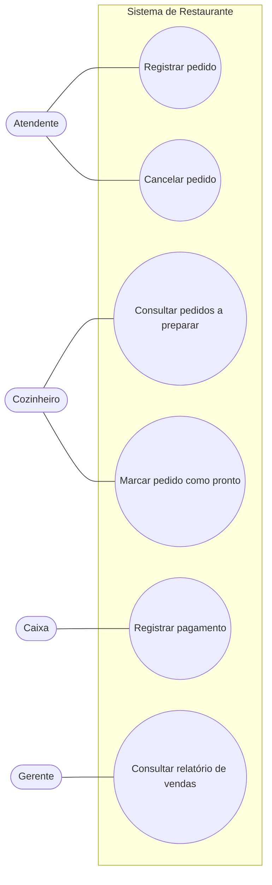
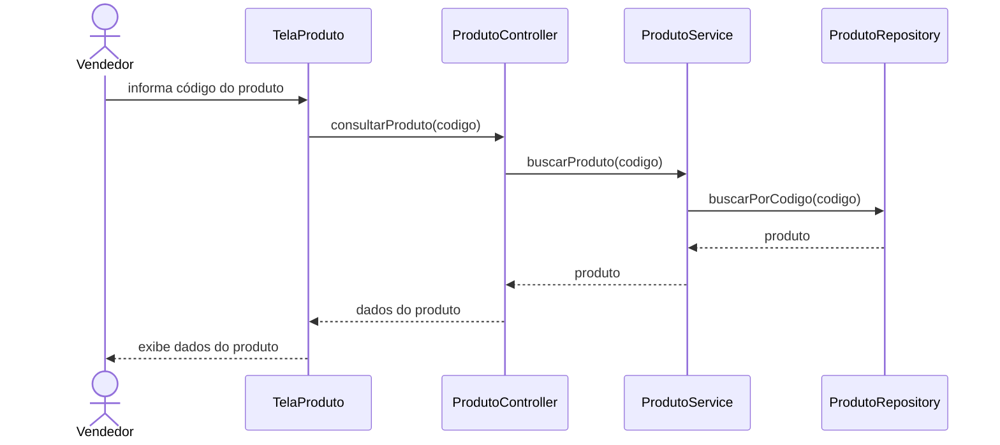
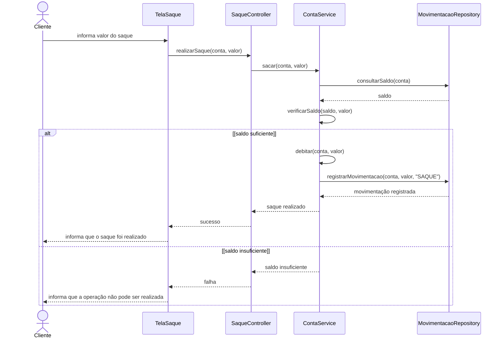
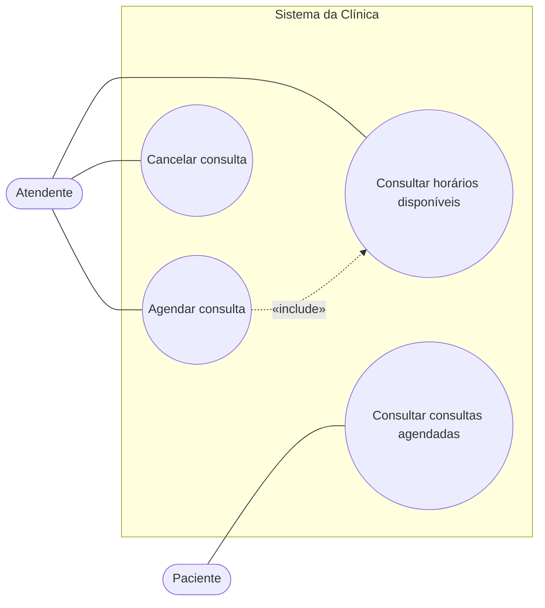
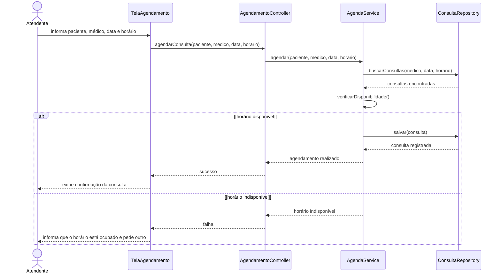

# Lista 05 - Análise e Projeto de Software (respostas)

# Exercício 1

**a)** Como cada desenvolvedor conversa com o cliente do seu jeito e implementa o que entendeu, duas pessoas podem entender a mesma necessidade de formas diferentes e o sistema acaba com comportamentos inconsistentes. Sem requisitos documentados não tem como conferir se o que foi entregue é o que o cliente pediu, então o retrabalho é comum. A falta de testes faz com que erros só apareçam quando o cliente já está usando, e qualquer alteração pode quebrar outra parte sem ninguém perceber. O conhecimento fica na cabeça das pessoas, então quando alguém sai da equipe ninguém sabe direito por que certas partes foram feitas daquele jeito, e a manutenção fica lenta e arriscada. Também fica difícil estimar prazo e custo, porque não existe uma sequência de trabalho definida para se basear.

**b)** Processo de desenvolvimento de software é a forma organizada como a equipe trabalha para sair de uma necessidade do cliente e chegar no software funcionando. Ele define quais atividades são feitas, em que ordem, quem é responsável por cada uma e quais artefatos são produzidos (documentos, modelos, código, testes). A ideia é que o resultado não dependa da forma pessoal de trabalhar de cada desenvolvedor.

**c)**
1. **Levantamento e especificação de requisitos:** entender com o cliente o que o sistema precisa fazer e registrar isso de forma que todos da equipe consigam consultar, incluindo as regras de negócio.
2. **Análise e projeto:** a partir dos requisitos, modelar o sistema (casos de uso, diagramas, arquitetura) e decidir como ele vai ser organizado antes de sair programando.
3. **Implementação:** escrever o código seguindo o que foi projetado e padrões combinados pela equipe, usando controle de versão.
4. **Testes:** verificar se cada funcionalidade faz o que o requisito diz, com testes que possam ser executados de novo sempre que o código mudar.
5. **Implantação e manutenção:** colocar o sistema em uso e tratar correções e mudanças de forma controlada, atualizando a documentação junto.

**d)** Com os requisitos escritos e validados com o cliente, todo mundo trabalha em cima da mesma definição, e não da interpretação de cada um. A análise e o projeto deixam registrado como o sistema funciona, então quando alguém sai da equipe o conhecimento continua nos modelos e documentos. Os testes mostram rapidamente se uma mudança quebrou algo e dão uma forma objetiva de dizer que uma funcionalidade está pronta. Padrões de código e controle de versão deixam o código mais fácil de entender por quem chegar depois. No geral o trabalho fica mais previsível e menos dependente de pessoas específicas.

---

# Exercício 2

**a) RN.** É uma restrição da locadora (e da lei). Valeria mesmo se o aluguel fosse controlado em papel.

**b) RF.** Descreve uma funcionalidade que o sistema precisa oferecer ao atendente.

**c) RN.** É uma política da empresa sobre como a locação funciona, não algo que o sistema "faz".

**d) RNF (desempenho).** Não diz o que o sistema faz, e sim quão rápido ele deve responder. Dá pra medir.

**e) RF.** É uma funcionalidade do sistema.

**f) RN.** É uma política da locadora para a categoria premium. O sistema vai ter que validar isso, mas a regra existe independente dele.

**g) RNF (segurança).** É uma restrição sobre como o sistema deve controlar o acesso, não uma funcionalidade de negócio. O login em si pode até aparecer depois como funcionalidade, mas a exigência de autenticação é de segurança.

**Diferença principal:** a regra de negócio pertence ao negócio. Ela diz o que pode ou não pode acontecer na empresa e continuaria existindo mesmo sem software. O requisito pertence ao sistema: diz o que o software deve fazer (RF) ou com que qualidade e restrições deve funcionar (RNF). Normalmente a regra de negócio aparece dentro de um requisito como uma validação. Por exemplo, a RN da habilitação vencida vira uma verificação dentro do RF de registrar locação.

---

# Exercício 3

**a) Regras de Negócio**
- RN01: Cada aula coletiva possui um limite máximo de participantes.
- RN02: Um aluno não pode ter duas reservas em aulas que acontecem no mesmo horário.
- RN03: Alunos com mensalidade vencida não podem fazer novos agendamentos.

**b) Requisitos Funcionais**
- RF01: O sistema deve permitir que o aluno consulte as aulas disponíveis.
- RF02: O sistema deve permitir que o aluno realize uma reserva em uma aula.
- RF03: O sistema deve permitir que o aluno cancele uma reserva.

**c) Requisitos Não Funcionais**
- RNF01 (desempenho): A consulta das aulas disponíveis deve mostrar o resultado em até 2 segundos.

É não funcional porque não acrescenta nenhuma funcionalidade nova, só define um limite de tempo de resposta para uma funcionalidade que já existe (RF01). É de desempenho porque fala de tempo e pode ser medido em teste.

**d)** A regra de negócio vira condição dentro do requisito funcional. No RF02 (realizar reserva), antes de gravar a reserva o sistema precisa checar se a aula ainda tem vaga (RN01), se o aluno já tem outra reserva no mesmo horário (RN02) e se a mensalidade está em dia (RN03). Se alguma falhar, a reserva não é feita. A RN01 também mexe no RF01, porque uma aula lotada não deveria aparecer como disponível, e no RF03, porque cancelar uma reserva libera uma vaga. Ou seja, uma mesma regra pode afetar vários requisitos, e um requisito pode depender de várias regras.

---

# Exercício 4

**a) Atores**
- Bibliotecário
- Aluno
- Coordenador da biblioteca
- Serviço externo de autenticação (ator secundário, é outro sistema)

**b) Casos de Uso**
- Registrar empréstimo
- Registrar devolução
- Consultar livros disponíveis
- Consultar histórico de empréstimos
- Cadastrar livro
- Bloquear usuário
- Autenticar usuário

**c) Relação entre atores e casos de uso**

| Ator | Casos de Uso |
|---|---|
| Bibliotecário | Registrar empréstimo, Registrar devolução, Autenticar usuário |
| Aluno | Consultar livros disponíveis, Consultar histórico de empréstimos, Autenticar usuário |
| Coordenador | Cadastrar livro, Bloquear usuário, Autenticar usuário |
| Serviço de autenticação | Autenticar usuário (valida o acesso) |

**d)** Sim. Ator é qualquer coisa fora do sistema que interage com ele, pode ser uma pessoa ou outro sistema. O serviço de autenticação não faz parte do sistema da biblioteca, mas o sistema troca informações com ele para validar o acesso. Ele entra como ator secundário, porque não é ele quem inicia o caso de uso, ele só é chamado durante a execução.

**e)** Porque essas coisas são passos de interface, não objetivos do usuário. Um caso de uso representa algo que o ator quer conseguir com o sistema e que entrega algum resultado pra ele, como "Registrar empréstimo". Clicar no botão, abrir a tela e digitar a matrícula são só ações feitas dentro desse caso de uso, e ainda dependem de como a tela foi desenhada. Se fossem modelados como casos de uso o diagrama ficaria enorme, cheio de detalhe que muda toda vez que a interface muda, e perderia a função de mostrar o que o sistema oferece.

---

# Exercício 5

**a) Problemas encontrados**
1. Não diz o que está sendo reservado (quarto, mesa, aula?).
2. "Cliente escolhe" não diz o que ele escolhe.
3. "Sistema verifica" não diz o que é verificado nem qual regra está sendo aplicada.
4. "Abre a tela" é detalhe de interface e não acrescenta nada ao objetivo.
5. "Salva" e "finaliza" são vagos e "salva" é termo técnico; não dá pra saber o que acontece de fato nem o que o cliente recebe no fim.
6. Não existe nenhum fluxo alternativo ou de exceção. O que acontece se a verificação falhar?
7. Faltam objetivo, pré-condições e pós-condições.
8. Não aparecem as regras de negócio nem os requisitos ligados ao caso de uso.

**b)** São genéricas demais. Cada pessoa que ler pode imaginar uma coisa diferente: verificar disponibilidade? verificar pagamento? verificar cadastro? Com isso, quem for implementar vai ter que adivinhar, e quem for testar não tem como montar um caso de teste, porque não sabe qual é o comportamento esperado. Essas expressões também escondem as regras de negócio que deveriam estar explícitas no fluxo.

**c)** Objetivo, ator principal (e secundários, se houver), pré-condições, pós-condições, fluxos alternativos, fluxos de exceção, regras de negócio relacionadas e requisitos relacionados.

**d) Fluxo principal reescrito**

Como o enunciado não diz o que é reservado, considerei uma reserva de mesa em restaurante.

1. O cliente informa a data, o horário e a quantidade de pessoas da reserva.
2. O sistema verifica se existem mesas livres que comportem essa quantidade de pessoas na data e horário informados.
3. O sistema apresenta as mesas disponíveis.
4. O cliente escolhe uma das mesas.
5. O sistema apresenta um resumo da reserva (data, horário, mesa e quantidade de pessoas).
6. O cliente confirma a reserva.
7. O sistema registra a reserva vinculada ao cliente, com situação "confirmada".
8. O sistema informa ao cliente o código da reserva e os dados confirmados.

---

# Exercício 6

**UC01 - Registrar Reserva**

**Objetivo:** Registrar a reserva de um quarto para um cliente em um período, respeitando a disponibilidade dos quartos e as regras do hotel.

**Ator principal:** Atendente

**Pré-condições:**
- O atendente está autenticado no sistema.
- Os quartos do hotel estão cadastrados.

**Pós-condições:**
- Em caso de sucesso, a reserva fica registrada, ligada ao cliente, ao quarto e ao período, e o quarto passa a constar como ocupado nesse período.
- Se a reserva não for concluída, nada é alterado no sistema.

**Fluxo principal:**
1. O atendente informa o CPF do cliente.
2. O sistema localiza e exibe os dados do cliente.
3. O atendente informa a data de entrada e a data de saída.
4. O sistema verifica se a data de saída é posterior à data de entrada (RN02).
5. O sistema verifica se o cliente já tem reserva em algum dia desse período (RN03).
6. O sistema lista os quartos disponíveis para o período (RN01).
7. O atendente seleciona o quarto escolhido pelo cliente.
8. O sistema apresenta o resumo da reserva, incluindo a política de cancelamento sem cobrança até 24 horas antes do check-in (RN04).
9. O atendente confirma a reserva.
10. O sistema confirma que o quarto continua disponível e registra a reserva.
11. O sistema exibe o número da reserva e informa que ela foi registrada.

**Fluxo alternativo FA01 - Cliente não cadastrado**
1. No passo 2, o sistema não encontra o cliente.
2. O atendente cadastra o cliente com os dados informados por ele.
3. O fluxo volta ao passo 3.

**Fluxo alternativo FA02 - Alteração de quarto ou período**
1. No passo 8, o cliente pede para trocar o quarto ou as datas.
2. O atendente volta ao passo 3 (para trocar as datas) ou ao passo 7 (para trocar o quarto).

**Fluxo de exceção FE01 - Datas inválidas**
1. No passo 4, o sistema identifica que a data de saída não é posterior à de entrada.
2. O sistema avisa o atendente e pede novas datas.
3. O fluxo volta ao passo 3.

**Fluxo de exceção FE02 - Cliente já possui reserva no período**
1. No passo 5, o sistema encontra outra reserva do cliente que coincide com o período.
2. O sistema mostra a reserva existente e não permite continuar com essas datas.
3. O atendente pode informar outro período (volta ao passo 3) ou encerrar o caso de uso.

**Fluxo de exceção FE03 - Nenhum quarto disponível**
1. No passo 6 (ou no passo 10, se o quarto foi reservado por outra pessoa nesse meio tempo), o sistema não encontra quarto disponível.
2. O sistema informa o atendente.
3. O atendente pode tentar outro período (volta ao passo 3) ou encerrar o caso de uso sem registrar a reserva.

**Regras de Negócio relacionadas:** RN01, RN02, RN03 e RN04 (a RN04 só é informada ao cliente aqui; ela é aplicada de fato no caso de uso de cancelamento).

**Requisitos relacionados:** RF01.

**Como verificar se o caso de uso está coerente com as regras de negócio:**
Dá pra pegar cada regra e procurar em qual passo ela é verificada e qual fluxo trata o caso em que ela falha. Se uma regra não aparece em nenhum passo, ou aparece mas não tem tratamento para quando é violada, tem algo faltando. Também ajuda fazer o caminho contrário: tentar "furar" o fluxo, por exemplo imaginar um cliente tentando reservar um quarto ocupado, e ver se algum caminho do caso de uso deixaria isso passar. Montar uma tabela simples ligando regra → passo → fluxo de exceção e transformar essas situações em casos de teste deixa essa conferência bem mais objetiva.

---

# Exercício 7

**a) Atores:** Atendente, Cozinheiro, Caixa e Gerente.

**b) Casos de Uso:**
- Registrar pedido
- Cancelar pedido
- Consultar pedidos a preparar
- Marcar pedido como pronto
- Registrar pagamento
- Consultar relatório de vendas

**c) Diagrama de Casos de Uso**

**d)** A fronteira do sistema é o retângulo que envolve os casos de uso. Tudo que está dentro dela é responsabilidade do sistema; os atores ficam do lado de fora porque interagem com ele, mas não fazem parte dele. Ela serve pra deixar claro o escopo: o que o sistema vai fazer e o que não vai.

**e)** O ator é quem usa o sistema, um papel externo (pessoa ou outro sistema), como o Caixa. O caso de uso é uma funcionalidade que o sistema oferece para esse ator atingir um objetivo, como "Registrar pagamento". Um diz *quem*, o outro diz *o que* é feito.

**f)** Não. O diagrama de casos de uso só mostra quais funcionalidades existem e quais atores usam cada uma. Ele não mostra o que vem antes ou depois. Mesmo que na prática o pedido seja registrado, depois preparado e depois pago, o diagrama não representa isso. A ordem fica descrita no fluxo de cada caso de uso, ou em diagramas de sequência e de atividades.

---

# Exercício 8

**a) Diagrama de Sequência**

**b)** A TelaProduto. É a interface com a qual o vendedor interage, então é ela que recebe o código e repassa para dentro do sistema.

**c)** O ProdutoController. Ele recebe o pedido vindo da tela, chama o serviço e devolve a resposta, ou seja, coordena a operação sem ter a regra de negócio nem o acesso aos dados.

**d)** O ProdutoRepository. É ele que acessa onde os produtos estão guardados (banco de dados) e devolve o produto encontrado.

**e)** Porque no diagrama de sequência o tempo passa de cima para baixo. A posição vertical mostra o que acontece primeiro e o que depende do quê. Por exemplo, a tela só pode mostrar os dados depois que o repositório devolveu o produto. Se a ordem estiver errada, o diagrama passa a descrever um comportamento que não faz sentido ou que não é o que o sistema faz.

---

# Exercício 9

Como o único repositório disponível é o MovimentacaoRepository, considerei que o saldo da conta é obtido a partir dele.

**Finalidade do fragmento `alt`:** ele representa caminhos alternativos dentro da interação, parecido com um if/else. Cada parte do `alt` tem uma condição de guarda entre colchetes, e só a parte cuja condição for verdadeira é executada. Assim dá pra mostrar no mesmo diagrama o que acontece quando há saldo e quando não há, sem precisar de dois diagramas separados.

---

# Exercício 10

## Parte A - Regras e Requisitos

**a) Regras de Negócio**
- RN01: Um médico não pode ter duas consultas no mesmo horário.
- RN02: Somente horários disponíveis podem ser agendados.

**b) Requisitos Funcionais**
- RF01: O sistema deve permitir que o atendente registre consultas.
- RF02: O sistema deve permitir que o atendente cancele consultas.
- RF03: O sistema deve permitir que o paciente consulte suas consultas agendadas.
- RF04: O sistema deve permitir consultar os horários disponíveis de um médico em uma data.

O RF04 não aparece escrito como funcionalidade no enunciado, mas está implícito: o requisito de desempenho fala da "consulta dos horários disponíveis", então essa consulta precisa existir.

**c) Requisito Não Funcional**
- RNF01 (desempenho): O sistema deve apresentar os horários disponíveis em até 2 segundos.

É de desempenho porque não cria funcionalidade nova, só limita o tempo de resposta do RF04, e pode ser medido.

## Parte B - Caso de Uso

**UC01 - Agendar Consulta**

**Ator principal:** Atendente

**Objetivo:** Registrar uma consulta para um paciente com o médico, a data e o horário escolhidos, garantindo que o horário esteja livre.

**Pré-condições:**
- O atendente está autenticado e tem permissão para registrar consultas.
- O médico está cadastrado e possui agenda definida.

**Fluxo principal:**
1. O atendente informa o CPF do paciente.
2. O sistema localiza e exibe os dados do paciente.
3. O atendente informa o médico e a data desejados pelo paciente.
4. O sistema apresenta os horários disponíveis do médico nessa data (RF04, RNF01).
5. O atendente seleciona o horário escolhido pelo paciente.
6. O sistema apresenta o resumo da consulta (paciente, médico, data e horário).
7. O atendente confirma o agendamento.
8. O sistema verifica novamente se o horário continua disponível e se o médico não tem outra consulta nesse horário (RN01, RN02).
9. O sistema registra a consulta.
10. O sistema informa que a consulta foi agendada.
11. O atendente passa a confirmação ao paciente.

**Fluxo alternativo FA01 - Paciente não cadastrado**
1. No passo 2, o sistema não encontra o paciente.
2. O atendente cadastra o paciente.
3. O fluxo volta ao passo 3.

**Fluxo alternativo FA02 - Nenhum horário disponível na data**
1. No passo 4, o sistema informa que o médico não tem horários livres na data escolhida.
2. O atendente pergunta ao paciente outra data ou outro médico.
3. O fluxo volta ao passo 3.

**Fluxo de exceção FE01 - Horário ocupado na confirmação**
1. No passo 8, o sistema identifica que o horário foi ocupado por outro agendamento depois de ter sido exibido.
2. O sistema informa que o horário não está mais disponível e não registra a consulta.
3. O sistema apresenta os horários que ainda estão livres.
4. O fluxo volta ao passo 5.

**Pós-condições:**
- Em caso de sucesso, a consulta fica registrada, ligada ao paciente, ao médico, à data e ao horário, e esse horário deixa de aparecer como disponível para o médico.
- Se o agendamento não for concluído, nenhuma consulta é registrada.

**Regras de Negócio relacionadas:** RN01, RN02

**Requisitos relacionados:** RF01, RF04, RNF01

## Parte C - Diagrama de Casos de Uso

O "Agendar consulta" inclui "Consultar horários disponíveis", porque sempre que uma consulta é agendada os horários livres precisam ser consultados.

## Parte D - Diagrama de Sequência

## Parte E - Integração dos conceitos

Cada artefato responde uma pergunta diferente, e cada um vai detalhando o anterior:

- **Regra de Negócio:** *o que pode e o que não pode acontecer no negócio?* Fala das políticas da clínica, que existem mesmo sem sistema. Ex.: um médico não atende duas pessoas no mesmo horário.
- **Requisito:** *o que o sistema precisa fazer e com que qualidade?* Transforma a necessidade em algo que o software deve oferecer (RF) ou atender (RNF). Ex.: permitir registrar consultas; mostrar horários em até 2 segundos.
- **Caso de Uso:** *como o ator usa o sistema para atingir um objetivo, e o que acontece quando algo dá errado?* Descreve passo a passo a interação, mostrando onde cada regra é aplicada.
- **Diagrama de Casos de Uso:** *quem usa o sistema e para quê?* Dá a visão geral do escopo: atores, funcionalidades e quem se liga com quem, sem mostrar ordem nem detalhes.
- **Diagrama de Sequência:** *como as partes do sistema colaboram, e em que ordem, para executar um cenário?* Já é projeto: mostra as mensagens entre tela, controller, service e repositório, inclusive os caminhos diferentes com `alt`.

Seguindo essa ordem, dá pra rastrear uma regra do começo ao fim: a RN01 aparece como validação no RF01, vira o passo 8 do caso de uso e depois o `alt [horário disponível]` no diagrama de sequência.
